# نداء — Nidaa

**مواقيت صلاة دقيقة، وأذان في وقته، بتصميم «الليلة الذهبية».** تطبيق أندرويد عربي مبني على جدول المواقيت الفلسطيني الرسمي المضمَّن داخل التطبيق، يعمل كاملاً دون إنترنت.

---

## لقطات الشاشة

<table>
  <tr>
    <td align="center" width="50%">
      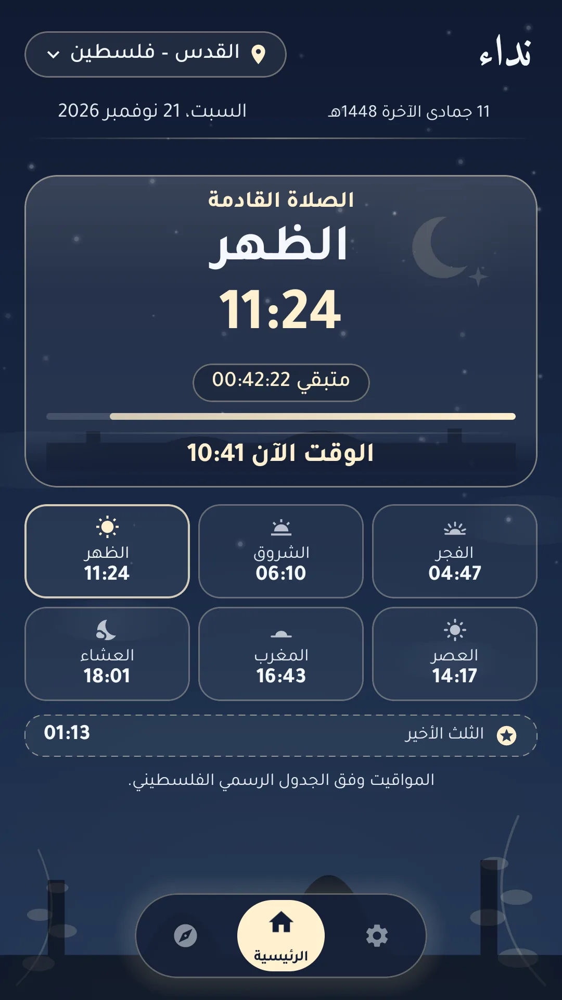 
      <b>لوحة الصلاة — المظهر التلقائي (النهار)</b>
    </td>
    <td align="center" width="50%">
      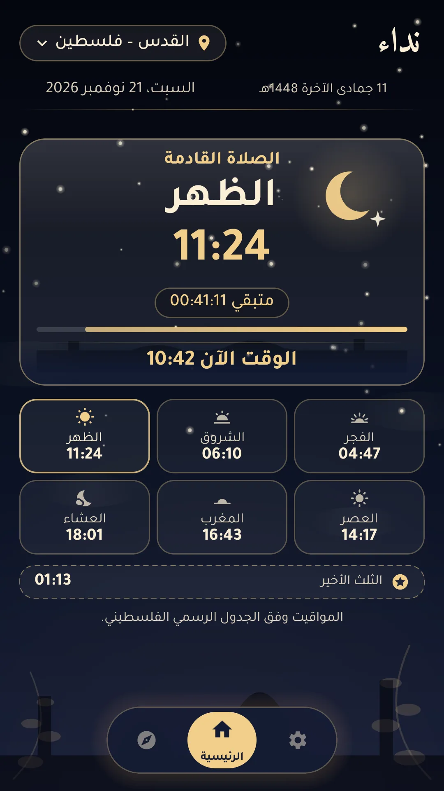 
      <b>لوحة الصلاة — المظهر الليلي (ذهبي)</b>
    </td>
  </tr>
  <tr>
    <td align="center" width="50%">
      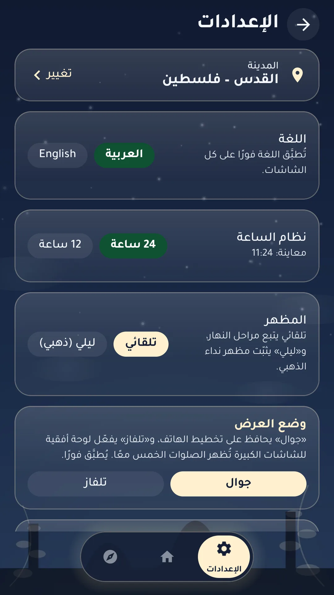 
      <b>الإعدادات — المدينة، اللغة، نظام الساعة، المظهر، وضع العرض</b>
    </td>
    <td align="center" width="50%">
      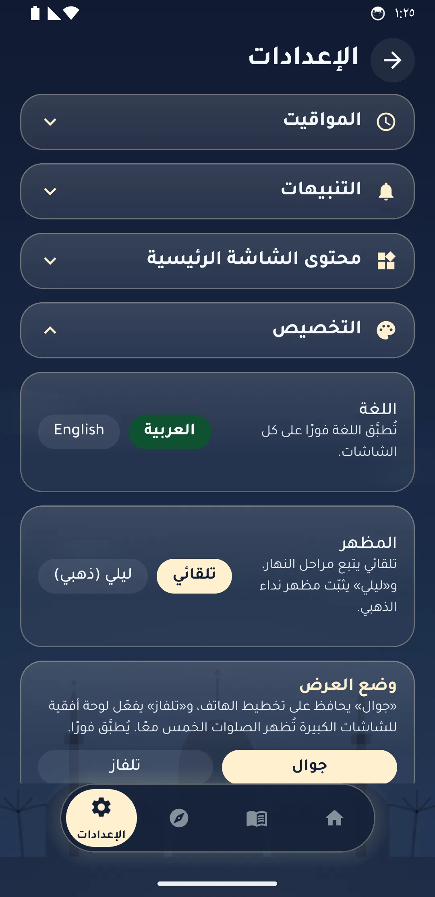 
      <b>الإعدادات — المظهر، وضع العرض (جوال / تلفاز)، حجم الخط</b>
    </td>
  </tr>
  <tr>
    <td align="center" width="50%">
      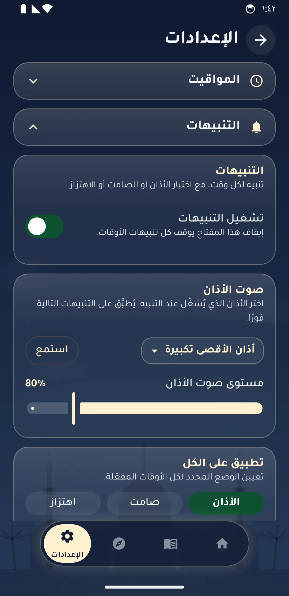 
      <b>التنبيهات — صوت الأذان، زر «استمع»، مستوى الصوت ٨٠٪</b>
    </td>
    <td align="center" width="50%">
      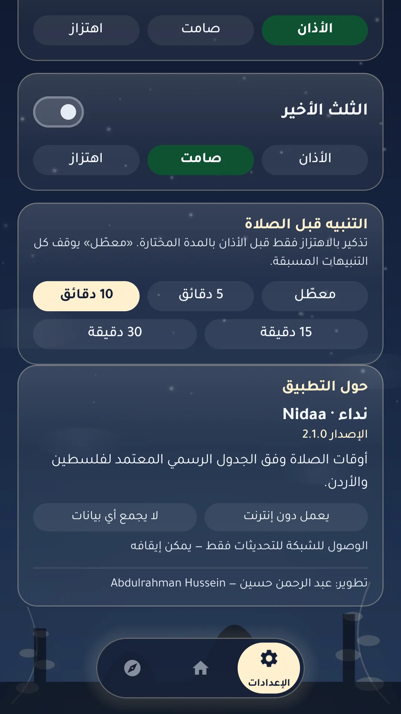 
      <b>التنبيه قبل الصلاة — معطّل / ٥ / ١٠ / ١٥ / ٣٠ دقيقة</b>
    </td>
  </tr>
  <tr>
    <td align="center" width="50%">
      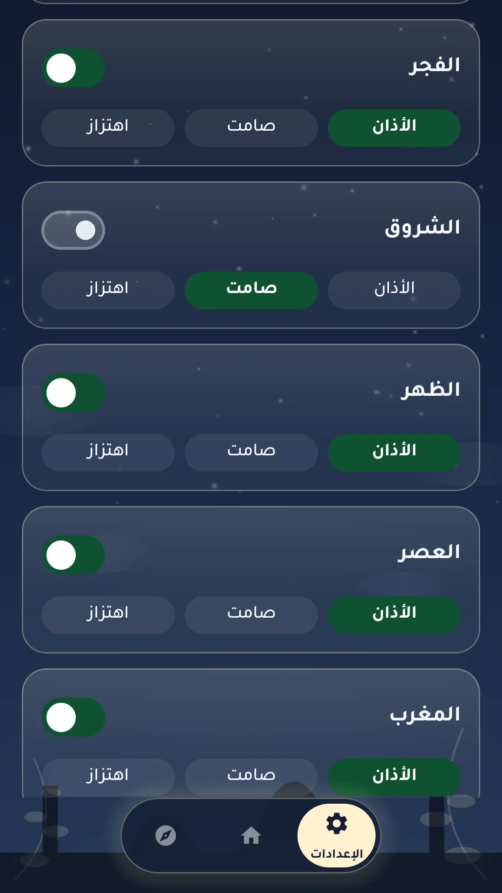 
      <b>بطاقات الصلوات — لكل صلاة مفتاح ووضع (أذان / صامت / اهتزاز)</b>
    </td>
    <td align="center" width="50%">
      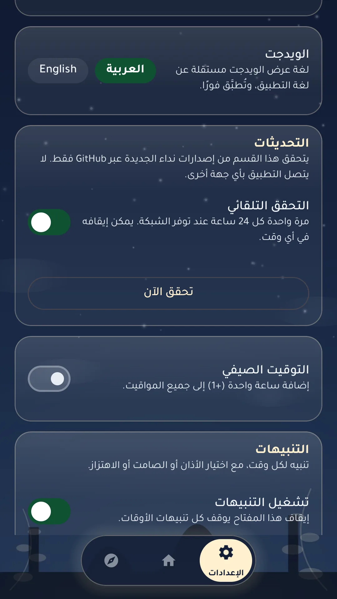 
      <b>التحديثات — التحقق التلقائي و«تحقق الآن»، التوقيت الصيفي، لغة الويدجت</b>
    </td>
  </tr>
  <tr>
    <td align="center" width="50%">
      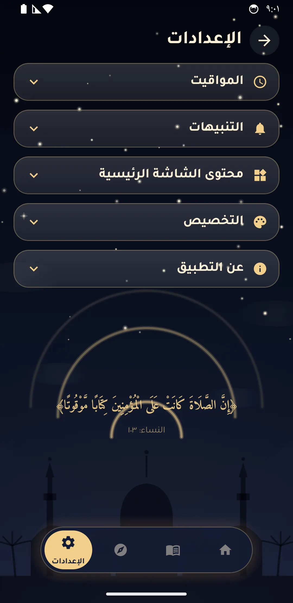 
      <b>الإعدادات — المظهر الليلي (ذهبي)</b>
    </td>
    <td align="center" width="50%">
      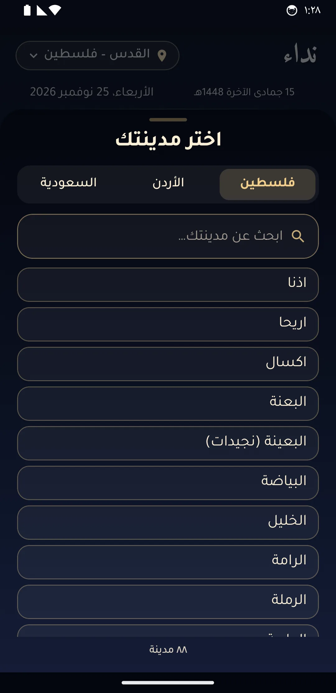 
      <b>منتقي المدينة — بحث فوري، تبويبات الدول، ٨٨ مدينة</b>
    </td>
  </tr>
  <tr>
    <td align="center" width="50%">
      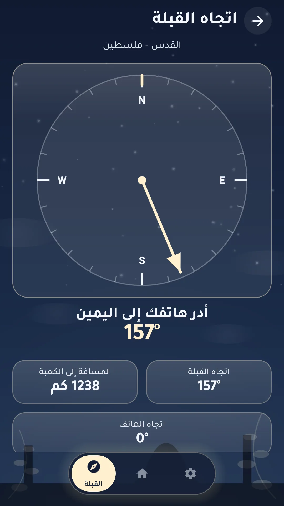 
      <b>اتجاه القبلة — البوصلة، المسافة إلى الكعبة، تلميح المعايرة</b>
    </td>
    <td align="center" width="50%">
      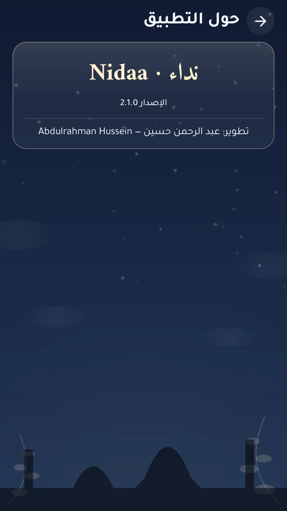 
      <b>حول التطبيق — نداء · Nidaa، الإصدار ٢٫١٫٠</b>
    </td>
  </tr>
  <tr>
    <td align="center" width="50%">
      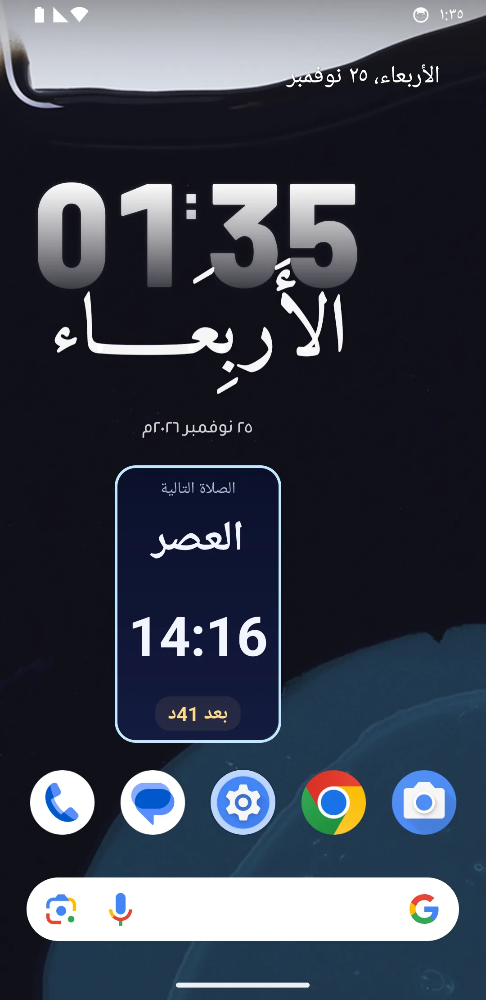 
      <b>الويدجت — الصلاة القادمة والعدّاد المتبقي</b>
    </td>
    <td align="center" width="50%"></td>
  </tr>
  <tr>
    <td align="center" colspan="2">
      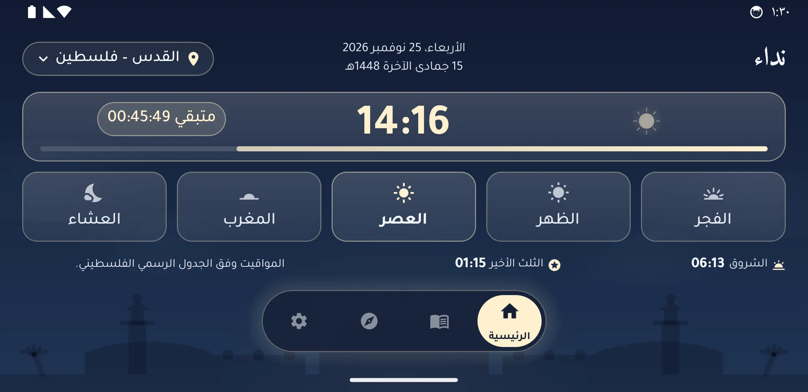 
      <b>وضع العرض التلفازي (أفقي) — المظهر التلقائي</b>
    </td>
  </tr>
  <tr>
    <td align="center" colspan="2">
      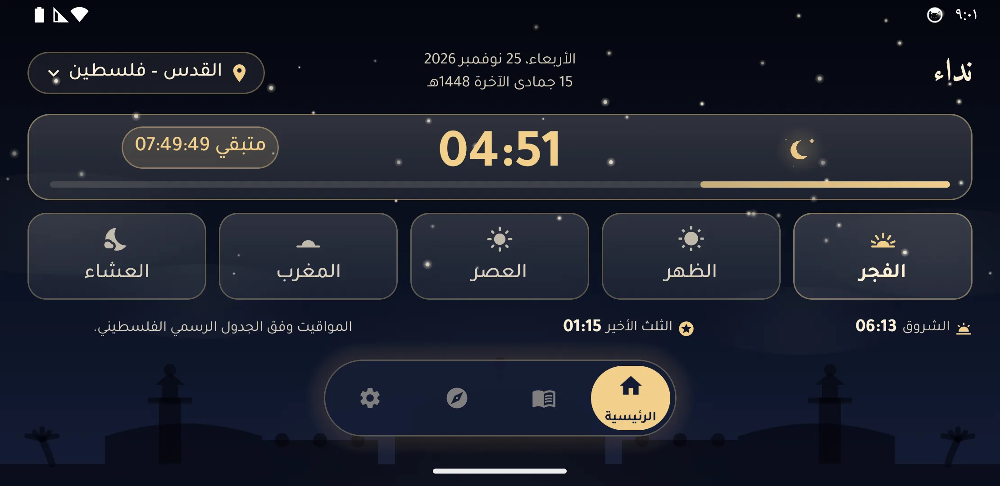 
      <b>وضع العرض التلفازي (أفقي) — المظهر الليلي (ذهبي)</b>
    </td>
  </tr>
</table>

> جميع اللقطات مأخوذة من إطار الجهاز بدقّته الأصلية على مدينة القدس، والواجهة عربية RTL بالكامل، ومستوى صوت الأذان ٨٠٪، والتنبيه قبل الصلاة ١٠ دقائق.

## المزايا

- **وضع العرض للتلفاز.** بدّل من الإعدادات بين «جوال» و«تلفاز»: في وضع التلفاز تتحوّل اللوحة إلى تخطيط أفقي واسع بخطوط أكبر، مناسب لشاشة التلفاز أو الجهاز اللوحي دون أي إعداد إضافي.
- **التنبيه قبل الصلاة.** تنبيه مبكّر قابل للاختيار: معطّل، أو ٥ / ١٠ / ١٥ / ٣٠ دقيقة قبل الأذان، لكل الصلوات.
- **مستوى صوت الأذان.** شريط صوت مستقل داخل التطبيق (٠–١٠٠٪) مع زر «استمع» لتجربة المستوى فوراً، ويُطبَّق على كل الصلوات بضغطة واحدة.
- **أذان أو صامت أو اهتزاز لكل صلاة** على حدة، مع منبّه دقيق (exact alarm)، وتذكير الثلث الأخير، وإظهار على شاشة القفل.
- **تحديث داخل التطبيق.** حزمة معزولة `com.nidaa.prayer.update` تتحقّق من إصدارات GitHub مرة كل ٢٤ ساعة (قابل للإيقاف أو «تحقق الآن»)، وتنزّل التحديث بعد التحقّق من بصمة **SHA-256** قبل فتح المثبّت.
- **RTL كامل.** الواجهة عربية من اليمين إلى اليسار في كل الشاشات — اللوحة والإعدادات والقبلة والويدجت — والاتجاه محفوظ حتى مع تغيير لغة النظام.
- **جدول المواقيت الرسمي أولاً.** كل وقت معروض هو بحث في الجدول الفلسطيني الرسمي نفسه (صف اليوم المتوافق مع السنة الكبيسة، فرق الدقائق لكل مدينة) — ٩٠ مدينة: ٨٨ فلسطينية + مكة المكرمة والمدينة المنورة.
- **سماء حيّة ومظهر «الليلة الذهبية».** ألوان الواجهة تتبدّل بين الفجر والنهار والذهب والليل بحسب وقت الجدول، مع هلال ونجوم في الليل، ومظهر ليلي ذهبي يمكن تثبيته يدوياً.
- **القبلة دون صلاحية موقع.** اتجاه القبلة يُحسب من إحداثيات المدينة المختارة؛ التطبيق لا يطلب صلاحية الموقع.
- **ويدجت الصلاة القادمة والويدجت الكامل** على الشاشة الرئيسية، قابلان للتحجيم، ولكل واحد لغة عرض مستقلة.
- **بلا إنترنت للعمل.** الجداول والأذان والواجهة كلها في الجهاز؛ بلا إعلانات، بلا تتبّع، بلا تحليلات، بلا جمع بيانات.

## التحميل

[**⬇ تحميل أحدث إصدار — nidaa.apk**](https://github.com/amh2002/Nidaa/releases/latest/download/nidaa.apk)

رابط ثابت يشير دائماً إلى أحدث إصدار منشور، فلا يتغيّر مع كل تحديث. التطبيق نفسه يتحقّق من بصمة **SHA-256** لأي تحديث قبل تنزيله وتثبيته، ويرفض أي حزمة لا تطابق البصمة المعلنة.

## التثبيت

1. نزّل ملف `nidaa.apk` من الرابط أعلاه.
2. افتح الملف على الهاتف، واسمح بالتثبيت من التطبيق الذي فتحته به («السماح من هذا المصدر» / «تثبيت تطبيقات غير معروفة»).
3. إن ظهرت رسالة Play Protect بعنوان «تطبيق غير آمن»: اضغط **«التفاصيل» ← «تثبيت على أي حال»**. هذا فحص سمعة للتطبيقات المثبَّتة خارج Google Play وليس فحص فيروسات.
4. **هواوي / هونر (EMUI):** الإعدادات ← الأمان ← «تثبيت تطبيقات خارجية»، اسمح للتطبيق الذي فتح الملف، وتأكّد أن **الوضع النقي (Pure Mode)** غير مفعّل له.
5. **شاومي / ريدمي (MIUI / HyperOS):** عند ظهور تحذير «حظر تثبيت التطبيقات»، اضغط «الإعدادات» ← فعّل «السماح من هذا المصدر»، وأوقف «فحص تطبيقات MIUI» أو اختر «تثبيت على أي حال».
6. بعد التثبيت اسمح بالبطارية غير المقيّدة (وفعّل «التشغيل التلقائي» على هواوي وشاومي عند ظهور البطاقة داخل التطبيق) — المواقيت الدقيقة تعتمد على ذلك.
7. **ملاحظة التحديث:** بعد تحديث التطبيق احذف الويدجت وأعد إضافته مرة واحدة، لأن أندرويد يحتفظ بمقاسات الويدجت القديمة.

## المتطلبات

- **أندرويد ٧٫٠ (API 24) أو أحدث** — `minSdk 24`، و`targetSdk 36`.
- مساحة تخزين تكفي لحجم الـ APK (نحو ٢٠–٣٠ ميجابايت).
- لا يحتاج إنترنت للعمل؛ الإنترنت مطلوب فقط للتحقق من التحديثات إن فعّلتها.
- لا يطلب صلاحية الموقع، ولا صلاحية جهات الاتصال، ولا أي صلاحية حساسة.

## التقنية

Kotlin + Jetpack Compose · `minSdk 24` و`targetSdk 36` · أوفلاين أولاً · بلا إعلانات، بلا متتبّعات، بلا تحليلات · `allowBackup=false` فلا تُنسخ الإعدادات خارج الجهاز · تحديثات موقّعة ومتحقَّق منها بـ SHA-256.
