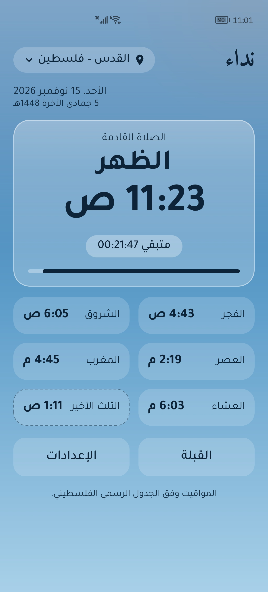
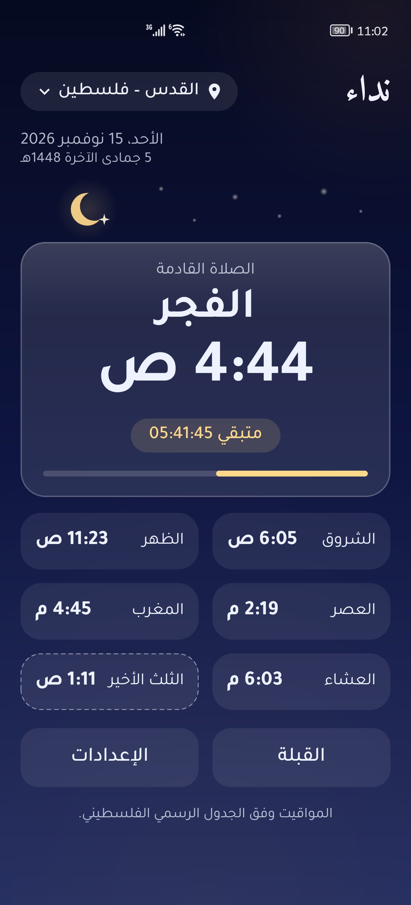
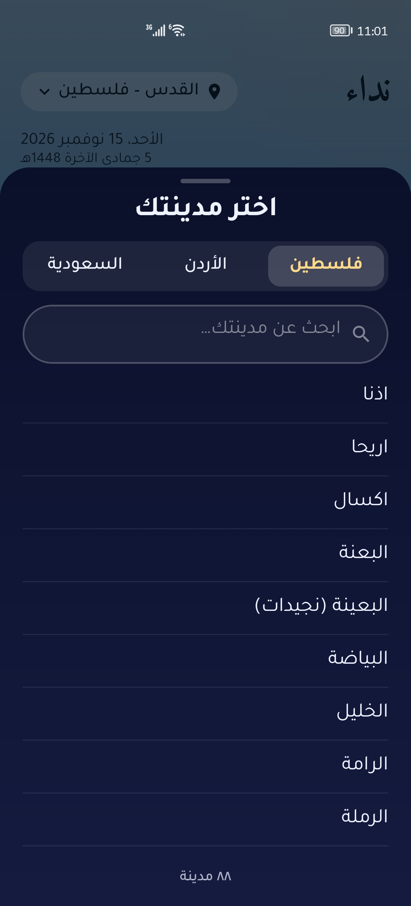
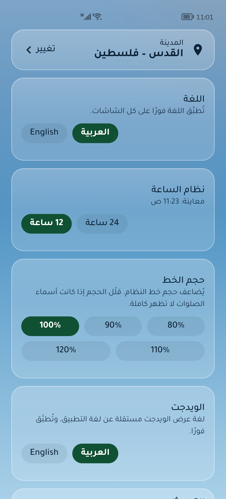
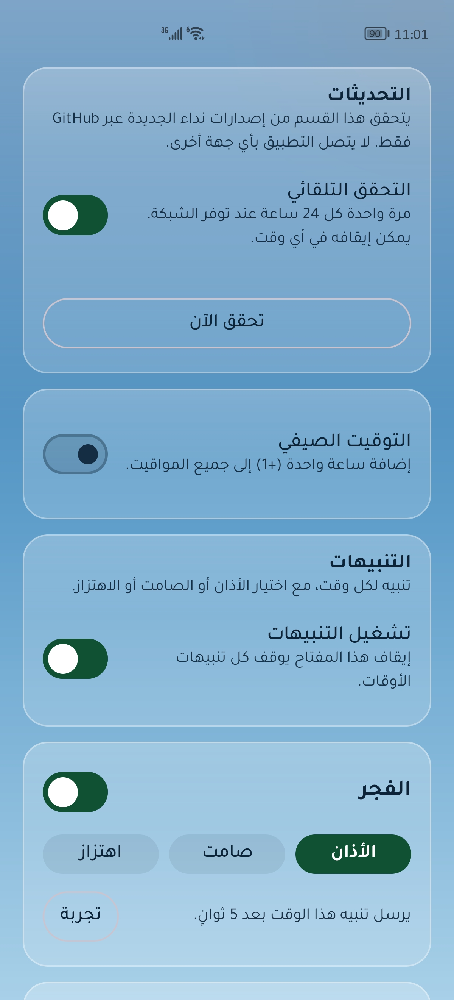

# نداء — Nidaa

**مواقيت صلاة دقيقة، أوفلاين أولاً.** تطبيق أندرويد عربي مبني على جدول المواقيت الفلسطيني الرسمي المضمّن داخل التطبيق، يعمل كاملاً دون إنترنت.

---

## لقطات الشاشة

<table>
  <tr>
    <td align="center" width="50%">
       
      <b>الشاشة الرئيسية — الصلاة القادمة الظهر ١١:٢٣ ص مع عدّاد تنازلي</b>
    </td>
    <td align="center" width="50%">
       
      <b>الشاشة نفسها ليلاً — الفجر ٤:٤٤ ص، سماء ليلية بنجوم وهلال</b>
    </td>
  </tr>
  <tr>
    <td align="center" width="50%">
       
      <b>اختيار المدينة — تبويبات فلسطين / الأردن / السعودية وبحث فوري (٨٨ مدينة)</b>
    </td>
    <td align="center" width="50%">
       
      <b>الإعدادات — المدينة، اللغة، نظام ١٢/٢٤ ساعة، حجم الخط، لغة الويدجت</b>
    </td>
  </tr>
  <tr>
    <td align="center" width="50%">
       
      <b>الإعدادات — التحديثات، التوقيت الصيفي (+١)، التنبيهات واختيار أذان/صامت/اهتزاز</b>
    </td>
    <td align="center" width="50%"></td>
  </tr>
</table>

## المزايا

- **جدول المواقيت الرسمي أولاً.** كل وقت معروض هو بحث في الجدول الفلسطيني الرسمي بالحساب الأصلي نفسه (صف اليوم المتوافق مع السنة الكبيسة، فرق الدقائق لكل مدينة، الساعة `%24` والتنسيق `%02d:%02d`) — ٩٠ مدينة: ٨٨ فلسطينية + مكة المكرمة والمدينة المنورة.
- **الشاشة الرئيسية.** الصلاة القادمة بخط كبير مع عدّاد تنازلي وشريط تقدّم، ثم الفجر والشرق والظهر والعصر والمغرب والعشاء، وبطاقة «الثلث الأخير» بخط منقّط، وتاريخ ميلادي وهجري (أم القرى).
- **سماء حيّة.** ألوان الواجهة تتبدّل بين الفجر والنهار والذهب والليل بحسب وقت الجدول، مع هلال ونجوم في الليل.
- **القبلة.** اتجاه القبلة محسوب من إحداثيات المدينة المختارة — التطبيق لا يطلب صلاحية الموقع.
- **تنبيهات لكل صلاة.** أذان بصوت مضمّن، أو صامت، أو اهتزاز، لكل صلاة على حدة، مع منبّه دقيق (exact alarm) وتذكير الثلث الأخير وإظهار على شاشة القفل، وزر تجربة للتنبيه.
- **ويدجت الرئيسية (٦ صلوات) وويدجت الصلاة القادمة** على الشاشة الرئيسية، كلاهما قابل للتحجيم، ولكل واحد لغة عرض مستقلة عن لغة التطبيق.
- **الإعدادات.** المدينة، العربية/الإنجليزية، نظام ١٢/٢٤ ساعة، حجم خط داخلي ٨٠٪–١٢٠٪، التوقيت الصيفي اليدوي (+١ ساعة)، لغة الويدجت، أوضاع التنبيه.
- **تحديث داخلي اختياري.** حزمة معزولة `com.nidaa.prayer.update` تتحقّق من إصدارات GitHub مرة كل ٢٤ ساعة (يمكن إيقافها)، وتنزّل التحديث بعد التحقّق من بصمة SHA-256 قبل فتح المثبّت.
- **بلا إنترنت للعمل.** الحساب والجداول والأذان والأذكار كلها في الجهاز؛ بلا إعلانات، بلا تتبّع، بلا تحليلات، بلا جمع بيانات.

## التثبيت

1. نزّل `Nidaa-1.0.0.apk` من صفحة الإصدارات: <https://github.com/amh2002/Nidaa/releases/latest>
2. افتح الملف على الهاتف، واسمح بالتثبيت من التطبيق الذي فتحته به («السماح من هذا المصدر»).
3. إن ظهرت رسالة Play Protect بعنوان «تطبيق غير آمن»: اضغط **«التفاصيل» ← «تثبيت على أي حال»**. هذا فحص سمعة للتطبيقات المثبّتة خارج Google Play وليس فحص فيروسات.
4. **هواوي / هونر (EMUI):** من الإعدادات ← الأمان ← مصادر خارجية، اسمح بالمصدر وأكّد التحذير، وتأكّد أن **الوضع النقي (Pure Mode)** غير مفعّل له. بعد التثبيت فعّل «التشغيل التلقائي» و«التشغيل في الخلفية» من إدارة تشغيل التطبيقات، واسمح بالبطارية غير المقيّدة عند ظهور بطاقة التنبيه داخل التطبيق — المواقيت الدقيقة تعتمد على ذلك.
5. **ملاحظة التحديث:** بعد تحديث التطبيق احذف الويدجت وأعد إضافتها مرة واحدة، لأن أندرويد يحتفظ بمقاسات الويدجت القديمة.

## التقنية

Kotlin + Jetpack Compose · ‏`minSdk 24` (أندرويد ٧.٠) و`targetSdk 36` · أوفلاين أولاً · بلا إعلانات، بلا متتبّعات، بلا تحليلات · `allowBackup=false` فلا تُنسخ الإعدادات خارج الجهاز.

---

## English

**Nidaa** (نداء) is an offline-first prayer-time app for Android, built on the official Palestinian timetable tables bundled inside the APK.

- Every displayed time is a lookup in those tables, not a re-computation: 90 cities (88 Palestinian, plus Makkah and Madinah), 392 reference vectors with 0 mismatches.
- Main screen: next prayer with a live countdown, the six prayer times, the last third of the night, Hijri + Gregorian dates, and a sky palette that follows the time of day.
- Qibla bearing from the selected city's coordinates — no location permission is requested.
- Per-prayer notifications: adhan, silent or vibrate, exact alarms, lock-screen visibility; two resizable home-screen widgets, each with its own language.
- Settings: city, Arabic/English, 12/24-hour, in-app font scale 80–120 %, manual summer time, notification modes.
- Optional in-app update check from GitHub Releases (isolated package `com.nidaa.prayer.update`, can be turned off, SHA-256 verified before install). No ads, no trackers, no analytics, no data collection.

**Install:** download `Nidaa-1.0.0.apk` from [Releases](https://github.com/amh2002/Nidaa/releases/latest), allow installs from your file manager, and if Play Protect warns, choose **More details → Install anyway** (it is a reputation check for sideloaded apps). Huawei users: allow the source, make sure Pure Mode is off for it, and enable auto-launch / background run. Requires Android 7.0+ (API 24).

After updating, remove and re-add the home-screen widgets once so the launcher picks up the new sizes.
